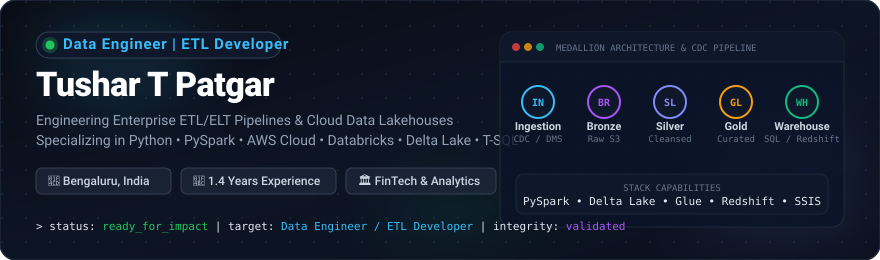

<!-- ========================================================
     GitHub Profile README -- Data Engineer Portfolio
     Tushar T Patgar -- Bengaluru, India
     ======================================================== -->

  

  

  
  
  
  
  
  

  
  
  
  
  

---

## 🧠 About Me

Data Engineer with **1.4 years of professional experience** developing enterprise-scale **ETL/ELT pipelines** and cloud-based data solutions across **FinTech** and **analytics** domains. I specialize in building robust data ingestion workflows, designing **Medallion (Bronze–Silver–Gold) lakehouses**, and implementing **automated reconciliation frameworks** that protect financial data integrity.

My core expertise spans **Python, PySpark, SQL, and T-SQL** combined with the modern cloud data ecosystem -- **AWS (S3, Glue, DMS, Lambda, Redshift, CloudWatch)**, **Databricks**, **Delta Lake**, **Apache Airflow**, **dbt**, and **SSIS**. I have demonstrated hands-on capability in orchestrating incremental processing, managing production cutovers, and delivering performant analytical data models.

### 🎯 Core Engineering Capabilities

| Focus Area | Engineering Capability & Impact |
| :--- | :--- |
| **Pipeline Architecture** | End-to-end ETL/ELT pipelines with schema enforcement, deduplication, and automated logging |
| **Lakehouse Design** | Medallion multi-hop storage (Bronze raw, Silver cleaned, Gold aggregated) with Delta Lake |
| **Incremental Processing** | High-performance upserts and merges utilizing Delta Lake `MERGE INTO` and SCD Type 1 & 2 logic |
| **Change Data Capture (CDC)** | Real-time and near real-time database replication via AWS DMS, Lambda triggers, and Glue jobs |
| **Data Quality & Integrity** | Reconciliation frameworks detecting schema drift, null anomalies, and reconciliation mismatches |
| **Cloud Analytics** | Scalable warehouse modeling on Amazon Redshift and SQL Server with query plan optimization |

---

## 📈 GitHub Telemetry

  

---

## 🛠️ Technical Skills

<table width="100%">
  <thead>
    <tr>
      <th width="28%" align="left">Domain</th>
      <th width="72%" align="left">Technologies &amp; Frameworks</th>
    </tr>
  </thead>
  <tbody>
    <tr>
      <td><strong>Programming &amp; Languages</strong></td>
      <td>
        
        
        
        
        
      </td>
    </tr>
    <tr>
      <td><strong>Big Data &amp; Processing</strong></td>
      <td>
        
        
        
        
        
      </td>
    </tr>
    <tr>
      <td><strong>Data Engineering Core</strong></td>
      <td>
        
        
        
        
        
        
        
      </td>
    </tr>
    <tr>
      <td><strong>AWS Cloud Platform</strong></td>
      <td>
        
        
        
        
        
        
        
        
        
        
      </td>
    </tr>
    <tr>
      <td><strong>Databases &amp; Warehouses</strong></td>
      <td>
        
        
        
        
      </td>
    </tr>
    <tr>
      <td><strong>Orchestration &amp; Tooling</strong></td>
      <td>
        
        
        
        
        
        
        
        
        
      </td>
    </tr>
  </tbody>
</table>

---

## 💼 Professional Experience

### 🏢 Software Engineer -- Wissen Digital Pvt Ltd
**July 2026 -- November 2026 · Bengaluru, India**
*FinTech Data Engineering & Cloud Solutions*

- **Data Pipeline Engineering:** Developed high-throughput Python- and SQL-based data pipelines for enterprise financial processing.
- **AWS Cloud Data Solutions:** Engineered and deployed cloud data processing architectures utilizing **Amazon S3, AWS Lambda, AWS Glue, Amazon EC2, and Amazon Redshift**.
- **Transformation & Quality Assurance:** Implemented robust business transformation logic with automated validation rules and schema enforcement.
- **Operations & Reliability:** Supported production incremental processing workflows, CloudWatch telemetry monitoring, and rapid ETL troubleshooting.

**Technologies Used:**
`Python` · `SQL` · `AWS S3` · `AWS Lambda` · `AWS Glue` · `Amazon Redshift` · `Amazon EC2` · `Amazon CloudWatch`

---

### 🏢 Data Engineer / ETL Programmer -- Endava Solutions Pvt. Ltd
**January 2025 -- January 2026 · Bengaluru, India**
*Enterprise Financial Datasets & Data Integration*

- **ETL Pipeline Development:** Designed, developed, and optimized SSIS-based ETL pipelines handling high-volume financial and transactional records.
- **Data Cleansing & Validation:** Built end-to-end extraction, transformation, cleansing, and business-rule validation workflows.
- **Reconciliation Frameworks:** Created comprehensive data quality and reconciliation frameworks to detect null anomalies, schema inconsistencies, and transaction imbalances.
- **Enterprise Migrations & Releases:** Led data extraction and verification for enterprise data migrations, merger integrations, and production cutovers.
- **Cross-Functional Collaboration:** Partnered closely with QA teams, business analysts, and client stakeholders to ensure SLA compliance and data integrity.

**Technologies Used:**
`SSIS` · `SQL Server` · `T-SQL` · `Data Modelling` · `Data Quality Validation` · `Reconciliation` · `SSMS`

---

## 🏗️ Featured Engineering Projects

### 1. 🏛️ SQL Data Warehouse
**Layered Medallion Architecture with Star Schema Data Modeling**

| Attribute | Implementation Details |
| :--- | :--- |
| **Objective** | Build an enterprise analytical data warehouse demonstrating end-to-end data warehousing best practices |
| **Architecture** | **Bronze (Raw Ingestion)** ➔ **Silver (Cleansed / Normalized)** ➔ **Gold (Business Dimensions & Facts)** |
| **Key Technical Deliverables** | • Star schema dimensional modeling with Fact and Dimension tables • T-SQL ETL extraction, cleansing, and loading workflows • Slowly Changing Dimensions (SCD Type 1 & Type 2) tracking historical changes • Query optimization, indexing strategies, and data reconciliation checks |
| **Technologies** | **SQL Server · T-SQL · Star Schema · Data Warehousing · SSMS** |

---

### 2. 🛒 Walmart Sales Analytics
**Databricks PySpark Lakehouse Pipeline with Incremental Delta Lake Upserts**

| Attribute | Implementation Details |
| :--- | :--- |
| **Objective** | Process, transform, and aggregate high-volume retail transactions for executive analytical reporting |
| **Architecture** | Databricks PySpark multi-stage pipeline utilizing Delta Lake table formatting and ACID transactions |
| **Key Technical Deliverables** | • Strict schema enforcement and handling of malformed records • Business-rule transformations, currency conversions, and time-based rolling aggregations • Incremental processing using Delta Lake `MERGE INTO` for efficient deduplication and upserts • Partition pruning and caching for optimized query execution |
| **Technologies** | **Databricks · Apache Spark · PySpark · Delta Lake · Python · Spark SQL** |

---

### 3. ⚡ AWS CDC Pipeline
**Event-Driven Change Data Capture with DMS, Lambda, Glue & S3 Lakehouse**

| Attribute | Implementation Details |
| :--- | :--- |
| **Objective** | Real-time capturing and automated lakehouse ingestion of operational transactional updates |
| **Architecture** | **AWS RDS (MySQL Source)** ➔ **AWS DMS** ➔ **Amazon S3 (Bronze)** ➔ **AWS Lambda Trigger** ➔ **AWS Glue ETL** ➔ **S3 (Curated Silver/Gold) / Amazon Redshift** |
| **Key Technical Deliverables** | • Continuous binary-log Change Data Capture (CDC) replication with AWS DMS • Event-driven serverless workflow invocation triggered by AWS Lambda on S3 landing • PySpark-based AWS Glue ETL transformation jobs performing deduplication and SCD tracking • End-to-end observability, alert routing, and metric logging configured via Amazon CloudWatch |
| **Technologies** | **AWS RDS · AWS DMS · AWS Lambda · AWS Glue · Amazon S3 · Amazon CloudWatch · Python · Spark** |

---

## 📦 Technology Stack Overview

| Layer | Technologies & Tools |
| :--- | :--- |
| **Languages** | Python · SQL · T-SQL · Spark SQL |
| **Big Data & Lakehouse** | Apache Spark · PySpark · Databricks · Delta Lake · Apache Kafka · Parquet |
| **AWS Cloud Services** | Amazon S3 · AWS Glue · AWS DMS · AWS Lambda · Amazon Redshift · AWS IAM · Amazon Athena · AWS Step Functions · Amazon CloudWatch · AWS CLI |
| **Relational & Cloud DBs** | Microsoft SQL Server · PostgreSQL · MySQL · Snowflake |
| **Orchestration & DevOps** | Apache Airflow · dbt · SSIS · Docker · Git · GitHub · GitHub Actions · Linux |
| **Development Tools** | SQL Server Management Studio (SSMS) · Visual Studio Code · Jupyter Notebook |

---

## 🏅 Certifications & Education

<table width="100%">
  <thead>
    <tr>
      <th width="50%" align="left">Certification / Degree</th>
      <th width="30%" align="left">Issuing Organization</th>
      <th width="20%" align="center">Type</th>
    </tr>
  </thead>
  <tbody>
    <tr>
      <td><strong>Python for Data Science</strong></td>
      <td>O'Reilly</td>
      <td align="center"></td>
    </tr>
    <tr>
      <td><strong>Microsoft SQL Server</strong></td>
      <td>O'Reilly</td>
      <td align="center"></td>
    </tr>
    <tr>
      <td><strong>SQL Server Integration Services (SSIS)</strong></td>
      <td>O'Reilly</td>
      <td align="center"></td>
    </tr>
    <tr>
      <td><strong>PySpark &amp; AWS: Master Big Data</strong></td>
      <td>O'Reilly</td>
      <td align="center"></td>
    </tr>
    <tr>
      <td><strong>Bachelor of Computer Applications (BCA)</strong></td>
      <td>Graduated 2020 – 2023</td>
      <td align="center"></td>
    </tr>
  </tbody>
</table>

---

## 🤝 Let's Connect & Collaborate

I am actively open to discussing **Data Engineering roles, ETL development, cloud data migrations, and lakehouse architectures**. Feel free to reach out directly through any of the channels below!

  
  &nbsp;&nbsp;
  
  &nbsp;&nbsp;
  
  &nbsp;&nbsp;
  

---

  <i>Designed with precision for <strong><a href="https://github.com/tusharpatgar">Tushar T Patgar</a></strong> -- Building reliable data pipelines, one dataset at a time.</i>

